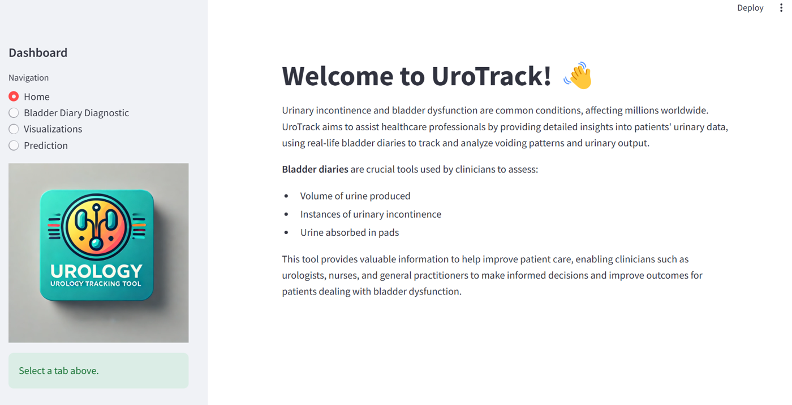
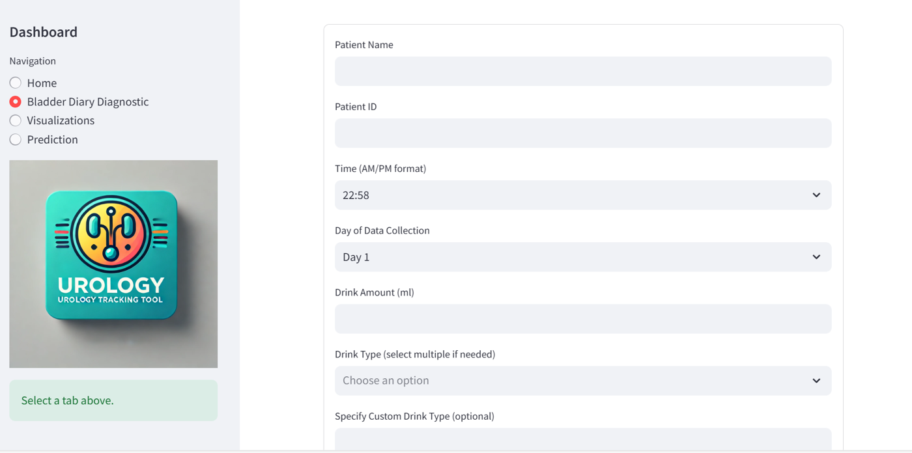
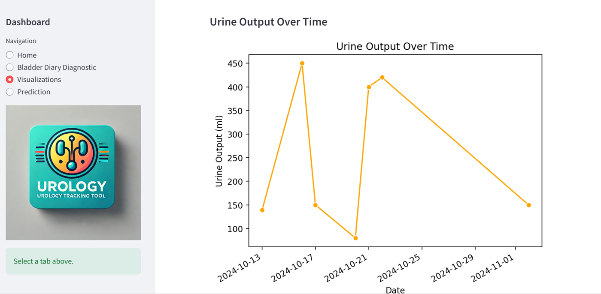
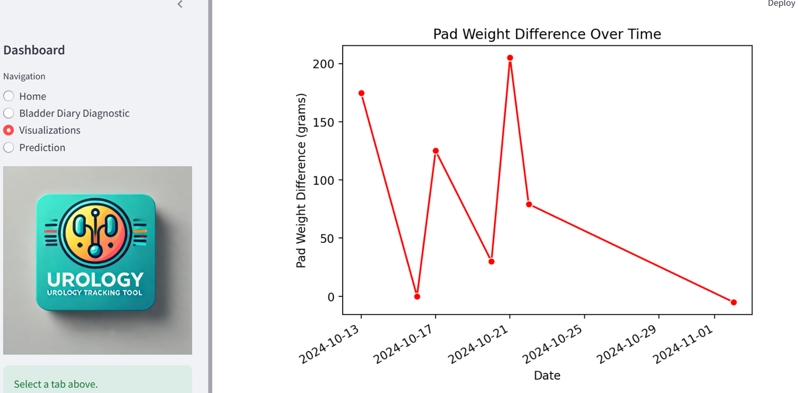
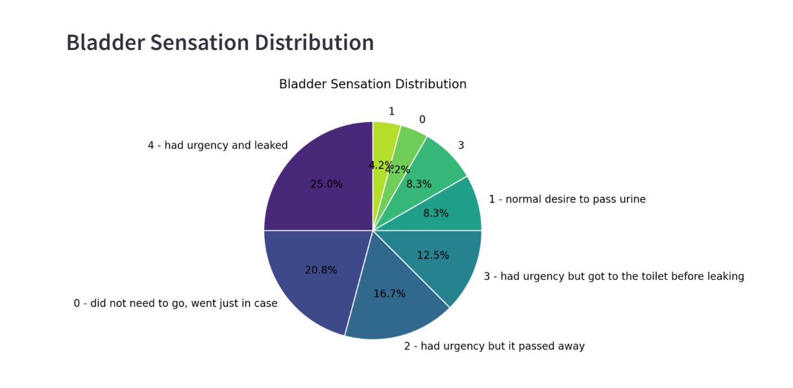
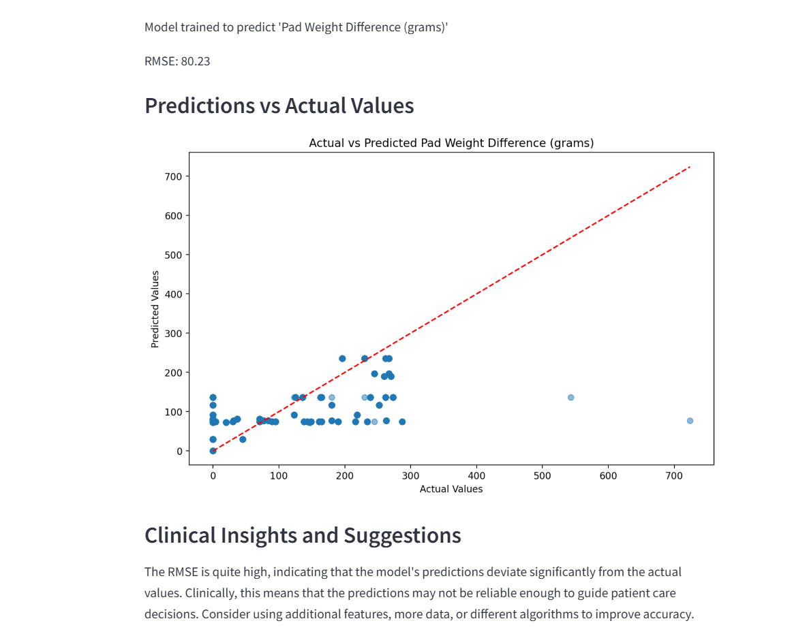
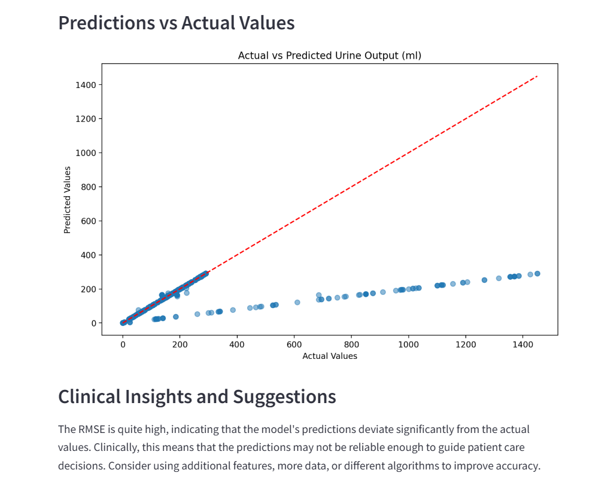

# 🩺 UroTrack — Bladder-Diary Diagnostic Tool for Lower Urinary Tract Symptoms

**UroTrack** is a web dashboard that turns a patient's **bladder diary** and **pad-weight test** into clear measures for clinicians: how much urine is produced, how often incontinence happens, and how much urine is lost in pads.

It was built in 2024 as a prototype with a **Stockholm medtech start-up** developing a diagnostic tool for lower urinary tract symptoms (LUTS), as a possible Master's thesis project in Health Informatics.

---

## 📌 Background

Urinary incontinence and bladder dysfunction affect millions of people worldwide. Clinicians (urologists, nurses and general practitioners) assess them with:

- **Bladder diaries** (frequency-volume charts): what the patient drinks, when they void and how much, and any leakage
- **Pad-weight tests**: the weight difference of used pads shows how much urine was lost

Both take time to fill in, add up and interpret.

## 🎯 Objectives

1. **Calculate and analyse urinary output** from a patient's voiding (bladder) diary.
2. **Measure urinary incontinence** from the amount of urine absorbed in pads.
3. Present the results so clinicians can make faster, better-informed decisions.

## 🧭 Method

| Step | What was done |
|---|---|
| **1. Scope** | Requirements agreed with the start-up founder; review of ICS-validated voiding diaries, pad-weight tests and the literature |
| **2. Data entry** | Diary form per patient: patient ID, time, day of collection, drink amount and type, voided volume, pad weights, bladder sensation |
| **3. Calculate** | Urine output over time, and pad weight difference (urine leaked) |
| **4. Visualise** | Trends over time and the distribution of bladder sensation (ICS scale 0–4) |
| **5. Predict** | Regression models for pad weight difference and urine output, with a plain-language clinical note on how reliable each prediction is |

## 🖥️ The Prototype

The dashboard has four sections: **Home**, **Bladder Diary Diagnostic** (data entry), **Visualizations** and **Prediction**.

| Diary entry | Urine output over time |
|---|---|
|  |  |

| Pad weight difference | Bladder sensation |
|---|---|
|  |  |

## 📊 Results So Far

| Predicting… | Result | What it means |
|---|---|---|
| Pad weight difference | RMSE ≈ 80 g | Too imprecise to guide care. The tool tells the clinician this directly. |
| Urine output | Large volumes underestimated | More data and features needed |

| Pad weight: predicted vs actual | Urine output: predicted vs actual |
|---|---|
|  |  |

- The working prototype was presented to the start-up in **November 2024**, and they invited me to continue the work with them.
- The prediction models are a **proof of concept**: they were trained on prototype diary data, not on real patients.

## ⚠️ Limitations

- **No real-world dataset yet.** All results come from prototype data, so they say nothing about clinical accuracy.
- The predictions are not reliable enough to guide patient care.
- The dashboard has not yet been tested with clinicians.

## 🗺️ Timeline

- [x] **Oct 2024:** scope agreed with the start-up founder (bladder diary + pad-weight test)
- [x] Reviewed ICS-validated voiding diaries, pad tests and the literature
- [x] Built the diary-entry form and web dashboard
- [x] Added visualisations and prediction models
- [x] **Nov 2024:** prototype presented; invited to continue with the start-up
- [ ] Collect real-world bladder-diary data
- [ ] Validate calculations and models with clinicians
- [ ] Market analysis of primary stakeholders (patients, clinicians) and secondary stakeholders (hospitals, insurers, regulators, device makers)

## 📚 References

- International Continence Society (ICS): [Bladder diary / frequency-volume chart](https://www.ics.org)
- Literature on voiding diaries and pad-weight testing as measures of incontinence severity

## 👤 Author

**Prabhu Raj Singh** — Specialist Dentist & Health Informatician · [LinkedIn](https://www.linkedin.com/in/prabhu-raj-singh-9a926a20)

> The prototype code is not yet published in this repository. For now it documents the project, its methods and its results.
